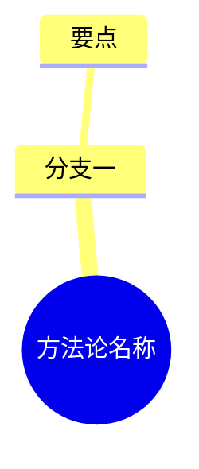

# 方法论名称

> 一句话说明结构

| | |
|---|---|
| 来源 | [标题](https://) |
| 案例背景 | 品类、规模、时间窗口 |
| 收录时间 | YYYY-MM-DD |
| 文件 | `SKILL.md` · `diagnosis.json` · `sources.md` |

## 一句话

## 脑图

## 评析

**可以直接拿来用的**：

**需要打折扣的**：
