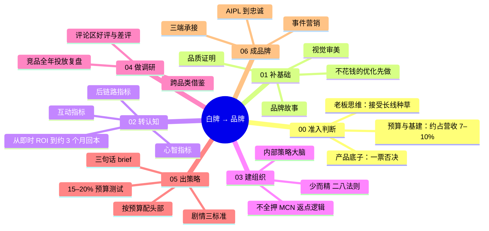

# 从白牌到品牌

> 00 准入判断 + 01–06 六步路径 + 阶段时间线

| | |
|---|---|
| 来源 | [抖音：好望水前操盘手分享](https://v.douyin.com/hyco-vQT08s/) |
| 案例背景 | 饮料品类，千万级 → 亿级，2021–2023 年抖音剧情内容红利期 |
| 收录时间 | 2026-10-26 |
| 文件 | [逐字稿](transcript.md) · `SKILL.md`（Claude skill）· `diagnosis.json`（自诊断网站数据）· `sources.md`（原始素材说明） |

## 一句话

品牌不是单一地赌爆款，而是一步步搭体系、攒认知。体系跑通的情况下，从零到一就是规模放大的事。

## 脑图

## 阶段时间线

| 阶段 | 规模 | 品牌预算 | 应做到 |
|---|---|---|---|
| ① 生死线 | 未稳定盈利 | 约为 0 | 00 产品底子判断 + 01 不花钱的部分 |
| ② 千万级 | 营收约 1000–3000 万 | 年约 70–300 万（推算） | 00 通过，01–04 做完，05 小额测试 |
| ③ 五千万级 | 营收 5000 万以上 | 年约 500 万（原文） | 05 测出打法后集中放大 |
| ④ 亿级前后 | 营收约 1 亿以上 | 单次投放 200–300 万以上 | 05 配头部背书，开始尝试 06 |
| ⑤ 品牌心智期 | 亿级以上 | — | 06 节点化事件营销 |

## 评析

**可以直接拿来用的**：三组替代即时 ROI 的指标、三句话 brief、"产品推动剧情"的标准、15–20% 的测试预算、按单次预算决定配不配头部。

**需要打折扣的**：

- 幸存者偏差和时间窗口：剧情号最优、CPM 10 以内是 2021–2023 年剧情红利期的结论，应作为待测试的假设。
- 数字口径不一致：原文营收和利润口径混用，套用前要先统一。
- 品类特殊：饮料客单价低、决策轻、送礼场景天然适合讲故事。客单价高、需要讲功能的品类，测评型内容的权重可能更高。
- 对 MCN 的立场：分享者第一步就是取消 MCN 合作。站在 MCN 一侧，这正是品牌方的典型顾虑，也是以"策略方而非返点方"服务品牌的机会。
