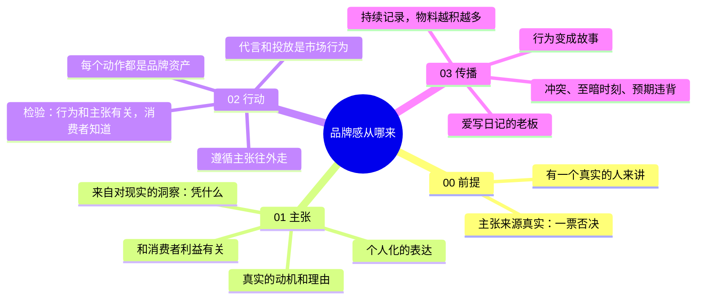

# 品牌感从哪来

> 00 前提 + 主张、行动、传播三步

| | |
|---|---|
| 来源 | [抖音「程前朋友圈」：白牌转品牌，品牌感是怎么来的](https://v.douyin.com/8kezV_bd9A8/) |
| 案例背景 | 程前朋友圈过去五年采访过的消费品牌传播案例，偏创始人 IP 驱动 |
| 收录时间 | 2026-10-26 |
| 文件 | [逐字稿](transcript.md) · `SKILL.md`（Claude skill）· `diagnosis.json`（自诊断网站数据）· `sources.md`（原始素材说明） |

## 一句话

同样的价钱、同一个货架，消费者径直拿走你的产品，靠的不是 logo、厂房和代言人，而是一个真实的主张，加上围绕它持续发生的行动，再把行动讲成故事。主张不变，行为不断，故事源源不断。

## 脑图

## 三步的检验标准

| 步骤 | 一句话 | 检验标准 |
|---|---|---|
| 01 主张 | 凭什么？ | 和消费者利益有关；有真实的动机和理由；由一个具体的人讲出来 |
| 02 行动 | 所有动作都是品牌资产 | 行为和主张有没有关系？消费者知不知道它们有关系？ |
| 03 传播 | 行动变成故事，故事产生传播 | 有没有持续的记录？讲出来的是有冲突的故事，还是成果展示？ |

## 评析

**可以直接拿来用的**：

- "凭什么"句式：把主张压成一句带不满和对象的话，比如"凭什么小个子买不着衣服"，能快速检验主张是不是和消费者有关。
- 品牌行为和市场行为的区分：判断标准只有一条，这件事和主张有没有关系、消费者知不知道。用这个标准能快速清理品牌预算里的无效动作。
- "主张 → 行为 → 故事"的链条：给内容团队一个找选题的方向，故事来自行动中的冲突，而不是凭空策划。

**需要打折扣的**：

- 幸存者偏差：案例都是上过程前朋友圈、愿意出镜的创始人。创始人不适合出镜的品牌，效率会明显打折扣，需要找其他真实的讲述者。
- 风险集中：品牌和创始人深度绑定，创始人出现负面事件时品牌会一起受损。
- 论据有瑕疵：用人名命名的百年品牌举例时，耐克的名字来自希腊胜利女神，并不是人名；梅赛德斯来自一位经销商女儿的名字，不是创始人。论点本身（个人化表达的传播效率高于群体形象）引用的是邹振东《弱传播》，但品牌举例不严谨。
- 没有衡量和预算：这套方法讲的是品牌内核，没有说明怎么衡量效果、花多少钱、在什么规模做。
- "品牌部人再多，不如一个爱写日记的老板"是修辞。日记要变成能传播的内容，仍然需要内容团队记录、剪辑和分发。

**和其他方法论的关系**：

- 与 [从白牌到品牌](../baipai-to-brand/) 互补。那一套讲的是怎么用投放和达人把认知做起来，这一套讲的是品牌内核从哪来。
  - 本方法的 01 主张，是对方 01 补基础里"品牌故事和品牌理念"的源头。
  - 本方法的 02 行动，和对方 06 的事件营销是同一个原则：让用户记住品牌做了什么事。差别在于这里要求行动长期持续，而不是一次性事件。
  - 两者对代言的看法不冲突：对方把头部达人用作背书和素材，本方法认为代言是市场行为，不能当成品牌建设的主体。
  - 本方法没有衡量指标，可以直接用对方 02 的三组指标（心智、互动、后链路）来衡量故事传播的效果。
- 与 [小预算滚雪球](../growth-positioning/) 衔接：认养一头牛创始人去香港给孩子买奶粉、萌生自己养牛的故事，就是本方法所说的主张；那一套在 06 把它做成了可复制的带货内容 SOP，说明主张和故事不只建立品牌感，也能直接带货。
- 与 [场景化五步法](../scene-five-steps/)：那一套第 04 步要求“把品牌主张变成有温度的故事”，但没有说主张和故事从哪来，正好用本方法补上。
- 与 [造梦体系](../dream-system/)：两者都讲“向往”，本方法的出发点是创始人的主张，那一套的出发点是用户的向往；两者都反对用明星代言做品牌。
- 与 [新品牌信任（柠檬市场）](../lemon-market-trust/)：本方法回答“凭什么做”，那一套回答“凭什么敢买”；本方法的主张和行动，是那一套能力、善意证据的来源。
- 对 MCN 来说，"爱写日记的老板"这一步正好需要专业的内容团队把创始人的经历记录、剪辑、分发出去，这是可以提供给品牌的服务。
