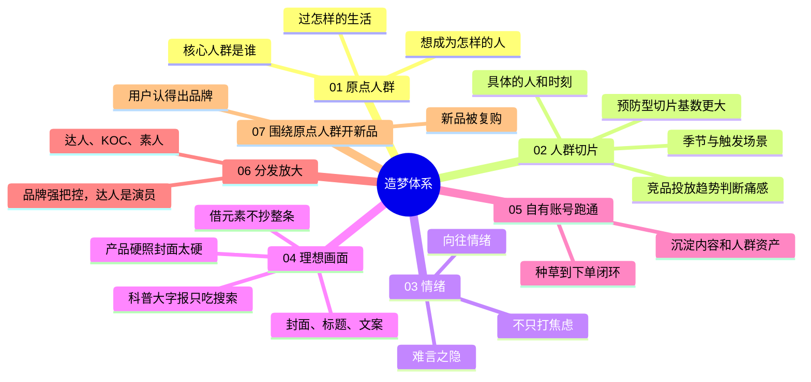

# 造梦体系

> 01–07 造梦路径（可直接套用的品牌内容方案框架）+ 内容电商四个段位

| | |
|---|---|
| 来源 | 讲者迪安的两段内容：内容电商四个段位（自述）+ 低客单新品小红书连麦咨询。原视频链接待补充 |
| 案例背景 | 平台以小红书为主；连麦案例是 39 元陈皮类口喷，只有咨询建议，没有执行结果 |
| 收录时间 | 2026-10-28 |
| 文件 | [逐字稿](transcript.md) · `SKILL.md`（Claude skill）· `diagnosis.json`（自诊断网站数据）· `sources.md`（原始素材说明） |

## 一句话

内容电商的起点不该是"什么内容容易爆"，而是品牌的核心人群是谁、在过怎样的生活、有什么没说出口的情绪、想成为怎样的人。从原点人群切到具体的人群切片，找到难言之隐和向往情绪，用封面、标题、文案构建理想画面；先在自有账号跑通，再交给达人分发；新品也围绕同一人群开，用户才会复购。

## 套用框架：造梦方案模板

做具体品牌推广时，直接按这六部分出方案。Claude 的 `dream-system` skill 也按这个结构输出。

**一、原点人群**：他是谁；他在过怎样的生活，和产品有关的是哪些时刻；他想要怎样的状态、想成为怎样的人。

**二、人群切片表**：切 3–5 个"具体的人 + 具体时刻"，并排出优先级。

| 切片 | 触发时刻或场景 | 难言之隐 | 向往画面 | 痛感和规模判断 | 优先级 |
|---|---|---|---|---|---|
| 例：夜里被孩子清嗓子惊醒的照护者 | 秋冬换季的夜里 | 孩子一直清嗓子，自己整晚睡不好，第二天还要上班 | 孩子和自己都睡个好觉 | 已有问题，痛但人群较小 | 二 |
| 例：换季提前准备的家长 | 降温、开空调 | 担心孩子换季出状况 | 不慌不乱，提前准备好 | 预防型，人群基数更大 | 一 |

排序依据：竞品近几个月在哪个人群上加投（更痛）；预防、提前准备型切片人群基数更大；落到情绪上才能和打"人群 + 场景"的竞品拉开差异。

**三、情绪和理想画面**：对优先切片各写一句难言之隐、一句向往画面、一句身份感（例如"我能把孩子照顾好"的全能妈妈）。焦虑可以出现，落点必须是向往画面。

**四、内容包**：每个优先切片给 3 条标题、2 个封面画面、正文结构（说中难言之隐 → 描绘向往画面 → 产品自然出现 → 回到身份感）、评论区引导、与竞品的差异、可借鉴的爆款元素（只借元素）。

**五、账号和分发计划**：先在自有账号跑通（能进推荐页、能出单），再把验证过的切片写成给达人、KOC、素人的选题和脚本；选题、脚本、封面、标题、评论区由品牌把控。

**六、新品延展**：同一原点人群在其他时刻的需求，作为 2–3 个新品方向，沿用同一套切片和画面语言。

**交付前自查**：主力内容不是科普大字报；封面不是产品硬照；没有整条复制爆款；不只打焦虑；达人不自由发挥；新品不和原点人群割裂；健康、保健、食品类不写预防、治疗等功效承诺。

## 脑图

## 案例：39 元陈皮类口喷（连麦咨询）

**背景**：母婴大品牌旗下新出的大健康产品，但不能借大品牌名义宣传，等于白牌；只有一个单品。目标是半年内在小红书做到月销 100 万（原文），营销费不设上限。卡点是流量成本高、内容表达可能有问题、没有连带和复购。

**讲者的诊断和建议**：

1. **先问清三件事**：对方的角色、背的指标、营销费多少，再给建议。
2. **选人群**：两个候选人群是换季时孩子的宝妈、用嗓的职业人群。竞品在用嗓人群上的投放在下降、在儿童人群上在上升，于是判断用嗓人群需求没那么痛，优先打宝妈；换季需求集中在秋冬。
3. **诊断内容**：
   - 品牌号做科普大字报，只能吃搜索流量，进不了发现页，转化低，而且这类内容已经泛滥；
   - 种草号的封面是产品图，太硬，拿不到流量。
4. **差异化打情绪**：竞品都在打"人群 + 场景"，很少打情绪。她切出三个切片：

| 切片 | 难言之隐 | 向往画面 |
|---|---|---|
| 夜里被孩子清嗓子惊醒的照护者 | 孩子一直清嗓子，自己整晚睡不好，第二天还要上班 | 低打扰，孩子和自己都睡个好觉 |
| 换季提前准备的人（建议重点打） | 担心降温、开空调后孩子出问题 | 不慌不乱，提前准备好 |
| 怕处理过度、又怕耽误的谨慎型家长 | 孩子白天正常，夜里偶尔异常 | 在微小变化出现时就有准备 |

5. **不要只打焦虑**：竞品可能在打家长焦虑，要描绘问题解决或准备好之后"我能把孩子照顾好"的全能妈妈画面。

注意：这是咨询建议，没有执行结果。儿童健康类产品写这些画面时，不能写成预防、治疗等功效承诺。

## 附：内容电商四个段位（次要，按需使用）

判断团队处在哪个段位是次要的。套用造梦体系做具体品牌推广时，只在团队做法明显卡在某个段位时参考。

| 段位 | 做法 | 问题 |
|---|---|---|
| 第一段位 | 借外部达人的账号和流量，达人自己想选题、写脚本；考核爆文率、CPC、CPE | 达人很难自然出爆款，还要另外花钱投流（小红书的乘风、聚光） |
| 第二段位 | 借壳生子：仍用外部达人，但选题、脚本、封面、标题、评论区由品牌强把控，达人只是演员 | 内容效率高，但流量仍在别人的账号上 |
| 第三段位 | 内容资产自有化：品牌号、员工号、素人号矩阵 + 内容中台 | 每个品和人群割裂、从零开始，没有复购；爆了就被抄；想转品牌时去找明星 |
| 第四段位 | 造梦体系：从原点人群出发 | 讲者认为是当下最适合品牌的内容电商玩法 |

## 评析

**可以直接拿来用的**：

- 四个段位：给团队定位内容能力的尺子，比"爆文率"更能说明问题出在哪里。
- 在"人群 + 场景"之上再加一层情绪：难言之隐和向往，是和竞品拉开差异的具体抓手。
- 用竞品投放趋势判断人群痛感：哪个人群上竞品在加投、哪个在减投，比主观判断可靠。
- 预防型切片比治疗型切片人群基数大，这个判断可以直接用于选人群。
- 先自有账号跑通，再交给达人分发：降低达人投放的试错成本。
- 新品围绕同一原点人群开：解决第三段位"每个品从零开始"的问题。

**需要打折扣的**：

- 案例没有结果：连麦只是咨询，讲者自己说的是"先按这个去试，应该会有一些结果"。前几套方法论大多来自做出过结果的操盘复盘，这一套的实操部分要当待验证的假设。
- 自我营销成分：自述中"半年内用 10% 营销费让多个品做到 TOP1"无法核实；"到第二段位薪资 1.5 万起，可以帮你介绍工作"属于引流话术。
- 平台差异：发现页、搜索页、乘风、聚光都是小红书的逻辑，换到抖音要重新验证。
- "第一段位过时"要放对位置：讲者批评的是让达人自由发挥、只看爆文率的做法，并不否定达人投放本身。
- 合规风险：儿童健康类产品的"造梦画面"很容易写成"换季不再担心宝宝感冒"这类功效承诺，普通商品不能这样宣称。

**和其他方法论的关系**：

- 与 [场景化五步法](../scene-five-steps/)：那一套做的是"人群 + 场景"，这一套明确在上面加了一层情绪；讲者说"竞品都在打人群 + 场景"，正是那一套的做法。
- 与 [小预算滚雪球](../growth-positioning/)：那一套切细分人群（在意奶源的宝妈），这一套切得更细，切到一个具体的人和他的一个具体时刻。那一套"用竞品已出货的达人和爆款找信号"，和这一套"用竞品投放趋势判断痛感"是同一类做法。
- 与 [从白牌到品牌](../baipai-to-brand/)：第二段位"品牌强把控脚本，达人当演员"，和那一套的三句话 brief、剧情号"产品推动剧情"是同一件事；那一套 03 建组织要求策略判断收回内部，对应这里从第一段位走向第二段位。
- 与 [品牌感从哪来](../brand-proposition/)：两者都讲"向往"，但那一套的出发点是创始人的主张，这一套的出发点是用户的向往；两者都反对用明星代言做品牌。
- 与 [新品牌信任（柠檬市场）](../lemon-market-trust/)：那一套的共情视角（“我先看见了你”）和本方法的难言之隐、向往情绪是同一个方向；本方法负责让用户心动，那一套负责让用户敢下第一单。
