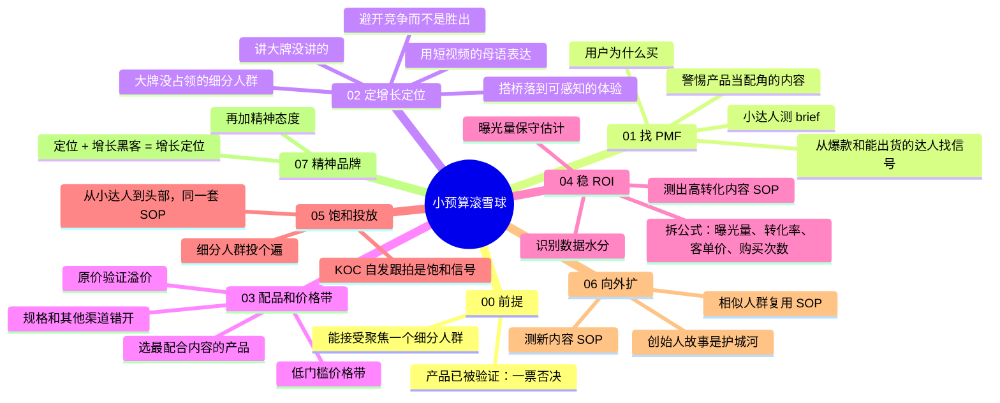

# 小预算滚雪球

> 00 前提 + 01–07 增长定位路径

| | |
|---|---|
| 来源 | [抖音「雅先生品牌短视频0-1增长」：品牌如何在短视频平台用小预算滚雪球](https://v.douyin.com/APkZWwjDCIA/) |
| 案例背景 | 认养一头牛 2018–2019 年在抖音、小红书从一两万预算起步的 0-1 增长；常温牛奶，利润薄；当时以挂车短视频为主 |
| 收录时间 | 2026-10-26 |
| 文件 | [逐字稿](transcript.md) · `SKILL.md`（Claude skill）· `diagnosis.json`（自诊断网站数据）· `sources.md`（原始素材说明） |

## 一句话

预算少、利润薄的品牌也能在短视频平台做到品效合一：先找到用户为什么买，用定位避开竞争，把 ROI 拆成可预测的曝光量和转化率，在一个细分人群里投到饱和，再向外扩，最后用精神态度驱动长期增长。

## 脑图



## 关键工具：ROI 拆解

```
ROI = GMV ÷ 投入金额
    = 曝光量 × 转化率 × 客单价 × 购买次数 ÷ 投入金额
```

- 保守起见先假设购买次数为一，复购和达人粉丝粘性都算作保守估计之上的额外收益。
- 曝光量：看达人后台的商单数据（通常比日常视频略差，更有参考价值），剔除个别爆款拉高的平均值。例如平均播放 50 万，但实际水平在 10–20 万，就按 15 万估。
- 识别水分：赞藏比是否合理、评论是否真实、每条视频的数据波动是否自然。
- 转化率：先假设达人没有粉丝粘性，只靠内容驱动成交；用小预算 A/B 测出转化率不低于某个数值的内容 SOP。

## 评析

**可以直接拿来用的**：

- ROI 拆解和保守预估法：把"玄学"的达人投放拆成能预测的两个变量，适合任何对 ROI 有硬要求的品类。
- "产品当配角"的陷阱：流量好但不转化时，先检查产品在内容里是不是可以随便替换的配角。
- "搭桥"：把品牌想讲的差异（养牛很用心）落到用户能感知的体验上（奶味清甜淡雅），和"农夫山泉有点甜"是同一个思路。
- 饱和信号：KOC 自发照着脚本拍视频带货，说明一个人群投透了；没出现就继续聚焦。这个信号可以直接写进投放复盘。
- 为内容选品、为平台定价，规格和其他渠道错开，用原价验证溢价。

**需要打折扣的**：

- 时间窗口：2018–2019 年是抖音、小红书的红利期，当时以挂车短视频为主，还没有成熟的直播间和纯佣 KOC。作者自己也说变的是"术"，49.9 元单箱装这类具体做法要按现在的平台重新测。
- 品类：常温牛奶利润薄，所以从第一天起就要求 ROI 可控。客单价高、毛利高的品类，约束没那么紧，可以更早投入长线心智。
- 案例只覆盖早期：作者 2020 年中离开，之后的规模化阶段不在本方法论范围内，也存在只讲成功经验的偏差。
- "搭桥"的前提是体验真实可感知。品牌宣称（如伙食费、没有用闪蒸技术）需要有依据，否则就成了夸大功效。
- 逐字稿里的转写错误："最好的站是不站"应为"最好的战是不战"，对应《孙子兵法》"不战而屈人之兵"的思想。

**和其他方法论的关系**：

- 与 [从白牌到品牌](../baipai-to-brand/) 的 ROI 观念看似相反，其实针对的是不同处境：
  - 那一套要求老板放下即时 ROI，用三组指标做长线种草，前提是有足够的品牌预算；
  - 这一套面对的是利润薄、预算只有一两万的品牌，必须让 ROI 从第一天起就可控。
  - 两者都强调先小额测试再放大、按 ROI 表现决定要不要上头部达人。这一套的"KOC 自发跟拍"，和那一套"头部达人给全平台达人做素材"是同一种势能。
  - 这一套的 01 找 PMF，可以用那一套 04 的竞品复盘和评论区分析来做。
- 与 [品牌感从哪来](../brand-proposition/) 衔接：认养一头牛创始人去香港给孩子买奶粉、萌生自己养牛的故事，就是那一套所说的"主张"；这一套的 06 把它做成了可复制的内容 SOP，07 的精神品牌和那一套的主张是同一个源头。
