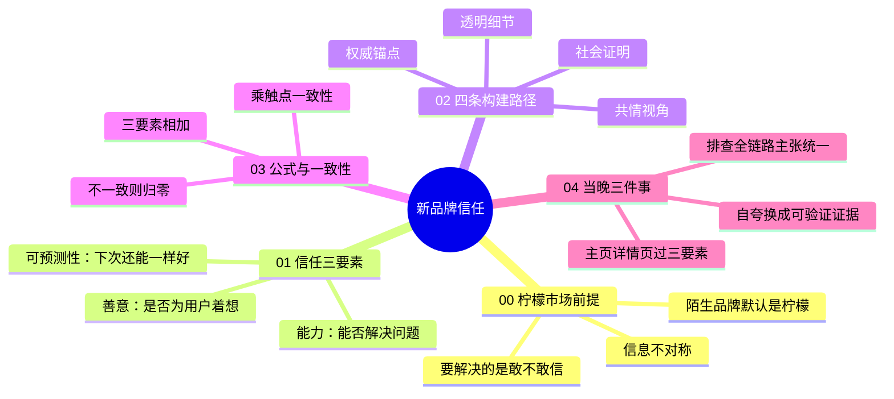

# 新品牌信任（柠檬市场）

> 00 柠檬市场前提 + 01 信任三要素 + 02 四条构建路径 + 03 公式与触点一致性 + 04 当晚三件事

| | |
|---|---|
| 来源 | [抖音「KAPI 卡皮品牌研究社」：新品牌该如何快速建立信任完成有效销售](https://v.douyin.com/8-TUvtqhSwM/) |
| 案例背景 | 以柠檬市场理论与信任三要素模型讲解新品牌信任；案例多为知名品牌一句话带过，无操盘预算与阶段数据 |
| 收录时间 | 2026-10-27 |
| 文件 | [逐字稿](transcript.md) · `SKILL.md`（Claude skill）· `diagnosis.json`（自诊断网站数据）· `sources.md`（原始素材说明） |

## 一句话

新品牌要过的不是“我怎么证明自己好”，而是柠檬市场里用户凭什么第一次就敢用真金白银相信你：把能力、善意、可预测性压进每一次触点，并用触点一致性放大信任。

## 脑图



## 结构一览

| 步骤 | 一句话 | 检验标准 |
|---|---|---|
| 00 前提 | 陌生品牌默认是柠檬 | 团队是否把问题定义成“用户凭什么敢信”，而不是只证明“我很好” |
| 01 三要素 | 能力、善意、可预测性 | 关键话术和页面能否同时回答这三问 |
| 02 四路径 | 权威、社会证明、透明、共情 | 至少有一条可验证的路径在跑，且不互相打架 |
| 03 公式 | 三要素 × 触点一致性 | 名字、视觉、内容、销售话术是否同一条价值主线 |
| 04 当晚三件事 | 立刻可执行的自查 | 三件事是否都做完并留下清单 |

## 核心公式

```
新品牌信任 =（能力 + 善意 + 可预测性）× 品牌触点一致性
```

前半段决定用户信不信你；后半段决定这份信任会不会在下一个触点当场归零。一致性为零，全盘归零。

## 评析

**可以直接拿来用的**：

- 把问题从“怎么证明我好”改写成“他凭什么第一次敢信你”。
- 信任三要素检查清单：能力、善意、可预测性，用来审主页、详情页和一句核心话术。
- 四条路径作为证据类型清单：权威背书、社会证明、透明细节、共情视角。
- “被记住不等于被信任”：重复口号只能提高记忆，不能单独完成信任。
- 当晚三件事，适合立刻做一轮自查。

**需要打折扣的**：

- 证据强度中等：框架来自公开理论与品牌例子，不是操盘者的预算、时间线和失败复盘；适合当检查清单，不适合当投放打法照搬。
- 案例偏知名品牌（润百颜、香飘飘、蜜雪冰城、胖东来、农夫山泉、内外等），小团队要换成自己够得着的第三方检测、真实追评、可公开的细节。
- 豆包对话里的“评论区观点”并非原视频实时评论，收录时不采信为来源事实。
- 没有阶段与预算口径：和 [从白牌到品牌](../baipai-to-brand/) 搭配时，用对方的阶段时间线决定什么规模才该放大品牌动作。

**和其他方法论的关系**：

- 与 [品牌感从哪来](../brand-proposition/) 互补：那一套讲主张、行动、故事从哪来；本方法讲第一次交易前的信任如何被设计和验证。主张回答“凭什么做”，三要素回答“凭什么敢买”。
- 与 [从白牌到品牌](../baipai-to-brand/)：对方 01 的品牌故事、品质证明，可以用本方法的三要素和四路径来写；对方强调投放与阶段，本方法补上信任诊断。
- 与 [小预算滚雪球](../growth-positioning/)：那一套的“搭桥”和真实体验，对应本方法的能力与可预测性；社会证明路径可接对方的 KOC 饱和信号。
- 与 [场景化五步法](../scene-five-steps/)：对方“承诺可视化”接近本方法的透明细节与可预测性；共情视角可用来写场景下的情感表达。
