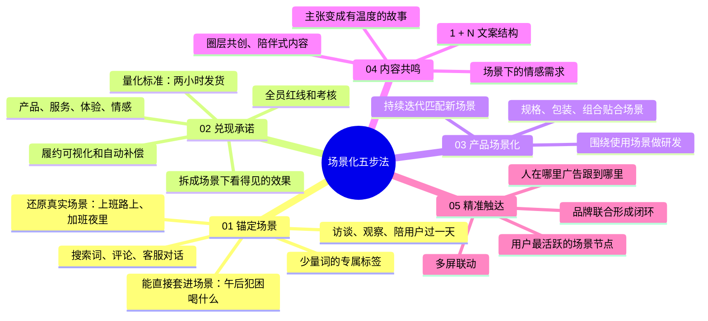

# 场景化五步法

> 场景痛点、承诺、产品、内容、触达五步

| | |
|---|---|
| 来源 | [抖音「品牌老枪」：从白牌到品牌的五步营销法](https://v.douyin.com/UuSYD4j5a9U/) |
| 案例背景 | 两人对话形式的框架梳理，没有操盘案例、预算和数据，品牌例子多为一句话带过 |
| 收录时间 | 2026-10-26 |
| 文件 | [逐字稿](transcript.md) · `SKILL.md`（Claude skill）· `diagnosis.json`（自诊断网站数据）· `sources.md`（原始素材说明） |

## 一句话

用户不再只想"我需要这个东西"，而是想"我在什么情况下需要它"。品牌要锚定一个具体场景的痛点，打造专属标签，把承诺拆成这个场景下看得见的效果，再让产品、内容和触达都围绕这个场景展开。

## 脑图

## 五步一览

| 步骤 | 一句话 | 检验标准 |
|---|---|---|
| 01 锚定场景 | 找到场景痛点，打造专属标签 | 用户一想到某个场景，就想到你的产品 |
| 02 兑现承诺 | 让信任看得见 | 承诺具体到场景、可量化、履约可见 |
| 03 产品场景化 | 围绕使用场景做研发 | 产品至少有一处为目标场景专门设计 |
| 04 内容共鸣 | 把主张讲成有温度的故事 | 评论里出现"这就是我" |
| 05 精准触达 | 出现在用户最活跃的场景节点 | 用户看到广告时觉得刚好需要 |

## 评析

**可以直接拿来用的**：

- "我在什么情况下需要它"这个视角：把泛泛的需求改写成具体场景，是写标签、写 brief、选投放位置的共同起点。
- 标签的句式："在某个场景下就用某产品"，例如"午后犯困就喝什么"。可以直接拿来检验现有的品牌口号。
- 承诺可视化的三层：拆成场景下的具体效果，变成可量化的标准，让履约过程对用户可见并设补偿机制。第三层在前三套方法论里都没有讲到，是这一套独有的部分。
- 1 + N 的文案结构：一个主情绪，延展成多个生活片段，适合给内容团队排选题。

**需要打折扣的**：

- 证据强度最弱：前三套都有操盘者的亲身案例和数字，这一套是框架梳理，没有预算、时间和数据，也没有失败的经验。从对话的节奏和措辞看，它很可能是 AI 生成的双人播客，适合当检查清单，不适合当打法照搬。
- 例子不严谨：品牌例子多是一句话带过，部分说不清是哪个品牌（如"做 AI 清干洗的家电品牌""办公咖啡"），无法核实；虎邦辣酱做小包装配外卖、小罐茶统一品质统一价格、喜茶"灵感之茶"、江小白朋友小聚等例子大体符合公开信息。
- 没有优先级和资源约束：五步同等展开，没有说预算少时先做哪一步。第 05 步的户外广告、多屏联动、品牌联合都需要不小的预算。
- 第 02 步的"全员红线、考核挂钩、自动预警"对大公司的服务流程更现实，小团队可以先从一条可量化、可公开的承诺做起。

**和其他方法论的关系**：

- 与 [从白牌到品牌](../baipai-to-brand/)：那一套的三句话 brief 第一句就是"打什么场景"，这一套把"场景"这一项展开成了完整的方法，可以用来写好那一句。
- 与 [小预算滚雪球](../growth-positioning/)：那一套的"搭桥，落到用户能感知的体验"和这一套的"把承诺拆成场景下看得见的效果"是同一个思路；那一套选细分人群，这一套选细分场景，两者可以叠加使用。预算少时，第 05 步可以换成那一套的细分人群饱和投放。
- 与 [品牌感从哪来](../brand-proposition/)：这一套第 04 步"把品牌主张变成有温度的故事"，主张从哪来、故事从哪来，可以用那一套的主张三要素和"行动变成故事"来补。
- 与 [造梦体系](../dream-system/)：本方法做的是“人群 + 场景”，那一套在上面加了一层情绪（难言之隐和向往），可以用来写好本方法第 04 步的内容共鸣。
